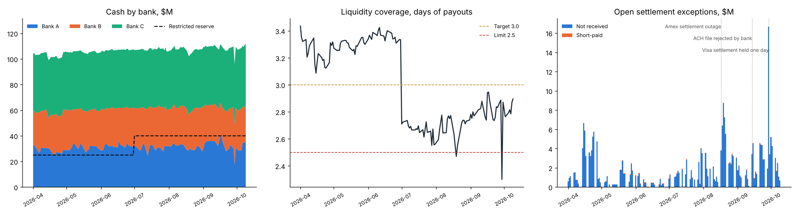

# Settlement & Liquidity Dashboard

The daily view for a card-payments treasury and operations team. It answers three questions:

- Did Visa, Mastercard, Amex, ACH and RTP pay what they owed?
- What is still open, and how old is it?
- Is there enough cash in the right accounts to pay merchants tomorrow?

The project has three parts:
- a **reconciliation engine** that matches expected settlements to bank statement lines,
- a **liquidity model** that applies the treasury sweep and prefunding policy,
- **daily alerts**, with the KPIs reproduced in **SQL**.

**[Open the dashboard](https://martinogie.github.io/settlement-liquidity-dashboard/)**: pick any day from April to October 2026, or jump to an incident.



## Results (1 Apr – 9 Oct 2026)

| | |
|---|---|
| Settlement batches | 4,690 ($3.35B) |
| Bank statement lines | 4,734 |
| Matched by the engine with no manual work | 99.7% of batches, 99.3% of lines |
| Engine precision vs. known truth | 100% (no wrong match proposed) |
| Engine recall | 99.7% (the rest went to the exception queue) |
| Days with a critical alert | 15 of 134 |

How the engine matched each batch:

| Pass | Rule | Batches |
|---|---|---|
| 1 | Reference found, amount agrees | 4,218 |
| 2 | Reference found, short-paid (variance raised) | 60 |
| 3 | Split across two lines with one reference | 36 |
| 4 | No reference: exact amount, same source and bank, value date −1 to +5 business days, one candidate each way | 337 |
| 5 | No reference: one line equals two or three netted batches | 24 |
| – | Matched by operations after investigation | 14 |
| – | Still open at period end | 1 |

The three injected incidents, and what the dashboard showed:

| Incident | What the dashboard flagged |
|---|---|
| Amex settlement outage, 17–19 Aug | Amex on-time rate fell to 38%; $8.8M of exceptions open; coverage fell to 2.47 days, below the 2.5 limit |
| ACH file rejected by the bank, 14 Sep | ACH on-time rate fell to 74%; critical alert for two days |
| Visa settlement held one day, 29 Sep | $12.1M moved from operating cash to prefund payouts; coverage fell to 2.3 days; Bank C rose to 49% of cash |

Finding: the scheme reserve requirement rose from $25M to $40M on 1 July. That kept coverage below
the 3-day target for all of Q3, so any network delay pushed it toward the 2.5-day limit. The
dashboard makes the case for a committed credit line or extra working capital before Q4 volume.

## What the dashboard shows each day

- **Six KPIs:**
  - available liquidity and days of payouts covered,
  - tomorrow's payouts and any prefunding top-up,
  - on-time settlement rate,
  - open exceptions,
  - exceptions older than 5 business days,
  - auto-match rate.
- **Alerts with thresholds:**
  - coverage below 3.0 days (warning) or 2.5 days (critical),
  - any source settling under 90% (warning) or 75% (critical) on time,
  - exceptions older than 5 business days,
  - unidentified cash over $250K,
  - any bank holding more than 45% of cash,
  - top-ups needed to prefund payouts.
- **Charts:** cash by bank, liquidity coverage, and open exceptions by type, each with a hover tooltip.
- **Settlement by source:** an aging heat table.
- **Detail tables:** the oldest open items and end-of-day account balances.

## Design choices

| Choice | Why |
|---|---|
| Matching passes run from most to least certain; ambiguous candidates are left unmatched | A wrong auto-match is worse than an exception: it hides a real break |
| Exceptions are aged in business days and shown "as of" each day | Ops escalates by age; a T+1 item on Monday is not late |
| Merchants are paid on schedule even when a network is late | That is the liquidity risk. Late settlements are funded from the company's own cash |
| Coverage = (cash − restricted reserve) ÷ average daily payouts | Restricted cash cannot pay merchants; days of payouts is easy to explain to a CFO |
| KPIs written again in SQL, tested against the Python | Shows the same numbers can feed a BI tool (Power BI, Tableau) straight from the warehouse |

## SQL

[`sql/kpis.sql`](sql/kpis.sql) has five named queries against a SQLite build of the data:
- match rate by rule,
- on-time settlement by source and month,
- open exceptions aging,
- liquidity coverage (window function),
- bank concentration.

Output is in [`reports/SQL_RESULTS.md`](reports/SQL_RESULTS.md).

## Quick start

```bash
pip install -r requirements.txt
python -m settlement.run                  # data, reconciliation, liquidity, SQL, reports, index.html (~6s)
python -m unittest discover -s tests      # 6 tests
sqlite3 reports/settlement.db < sql/kpis.sql
```

## Layout

```
settlement/data.py       synthetic settlement batches, bank lines and incidents
settlement/matching.py   five-pass reconciliation engine and scoring against truth
settlement/liquidity.py  daily balances by account, sweeps, prefunding, coverage, concentration
settlement/metrics.py    as-of exceptions, aging, on-time rates, alerts, operations case log
settlement/run.py        pipeline, SQLite load, SQL KPIs, chart, dashboard page
sql/kpis.sql             KPI queries
web/template.html        dashboard template (run.py writes index.html)
```

## Data note

All data is synthetic. It covers six months of settlement batches from five sources, with realistic:
- reference loss (ACH 30%),
- late, missing, short and split payments,
- ACH netting,
- unidentified wires,
- three injected incidents.

Because the true batch behind every bank line is known, the matching engine can be scored exactly.

## How this was built

Built with AI-assisted coding. Design, controls and review are my own.

## License

MIT
